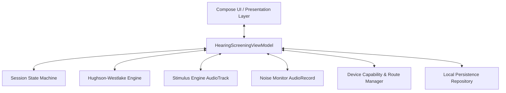
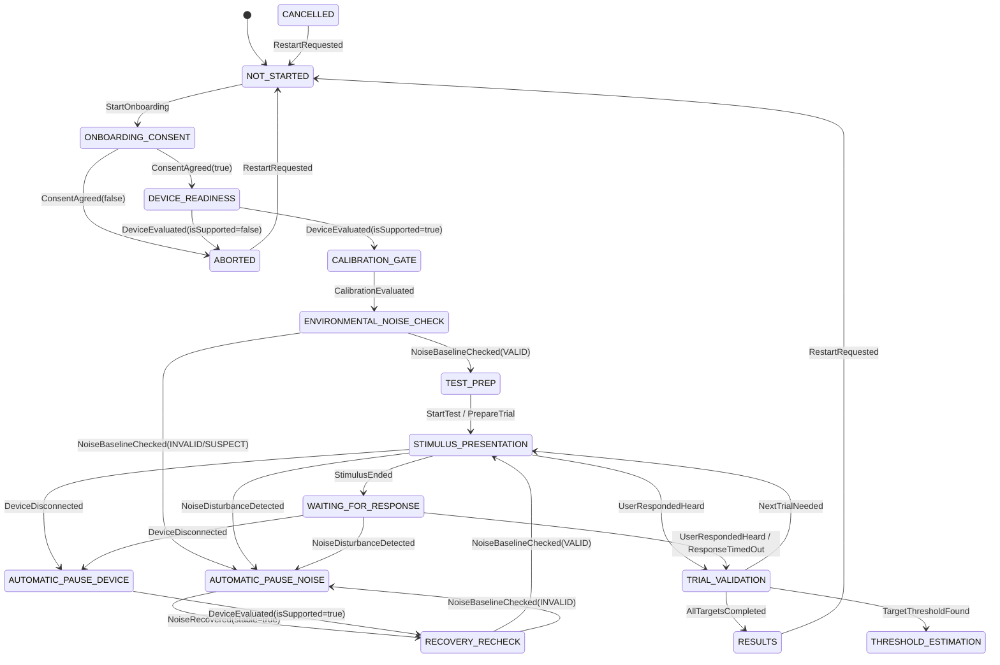
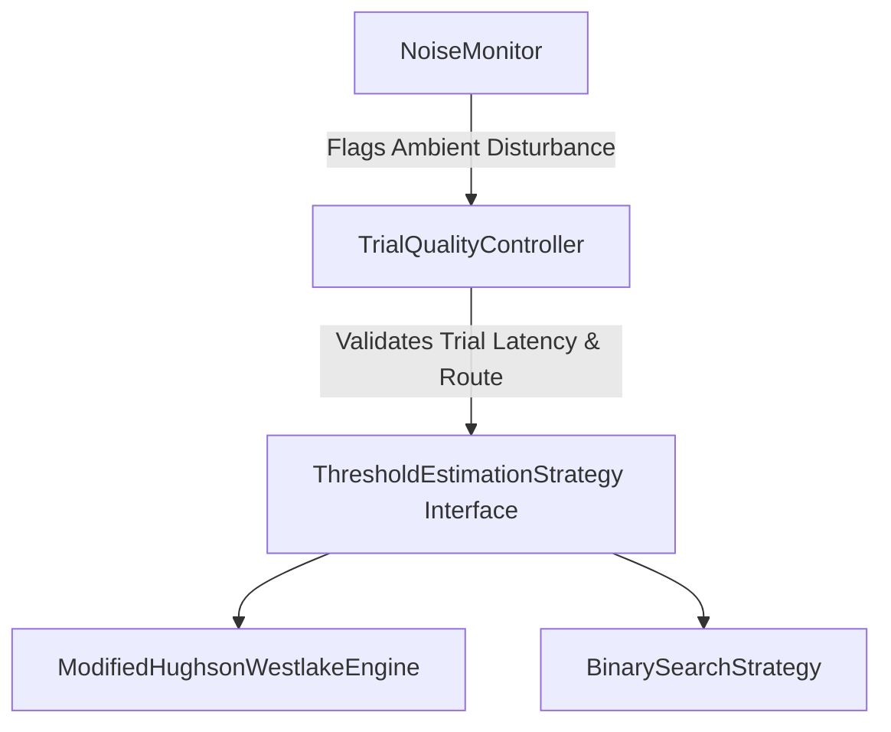
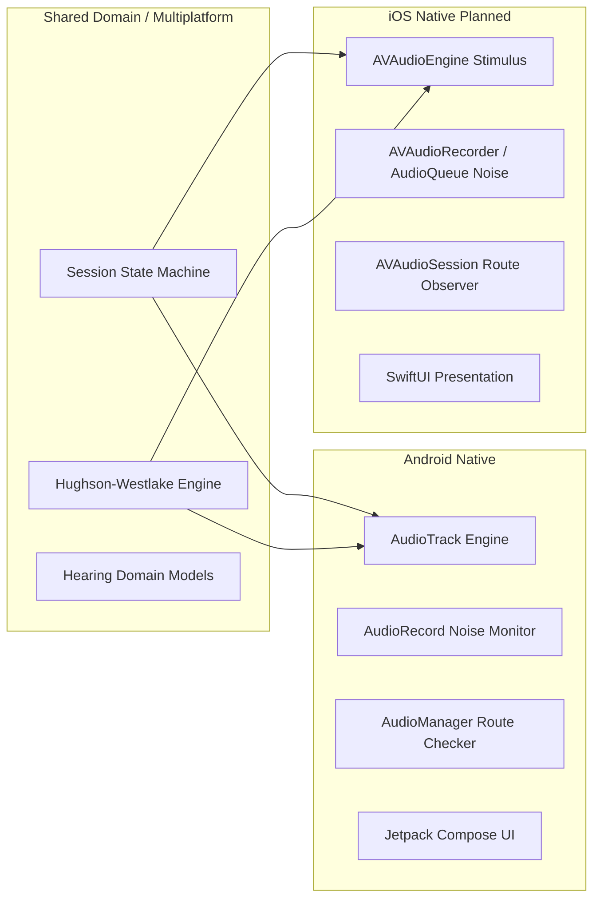

# ECHO Architecture Specification: Preliminary Hearing-Screening Android POC

## 1. System Overview & Product Vision
**ECHO** is a personalized hearing-health platform designed to bridge preventive hearing monitoring, personalized headphone listening limits, and hearing-assistance functionality. 

This repository delivers the **Stage-1 Proof of Concept (POC)**: a native, offline-first Android application implementing a self-administered **preliminary hearing screening** with real-time **environmental noise disturbance detection**, **audio route capability gates**, and a pure **Modified Hughson–Westlake staircase estimation engine**.



---

## 2. Architectural Principles & Boundary Separation
The application adheres strictly to Clean Architecture and Domain-Driven Design (DDD) to isolate medical-domain algorithms from platform-specific APIs:

1. **Domain Isolation**:
   - `HughsonWestlakeProtocol` and `SessionStateMachine` are pure Kotlin modules with zero Android dependencies. They can run on any JVM, native multiplatform runtime, or unit test runner without Android mocks.
2. **Adapter Decoupling**:
   - Platform services (`AudioTrack`, `AudioRecord`, `AudioManager`, file I/O) are hidden behind abstract contracts (`StimulusEngine`, `NoiseMonitor`, `DeviceCapabilityManager`, `SessionRepository`).
   - Every hardware adapter has a corresponding deterministic fake adapter (`FakeStimulusEngine`, `FakeNoiseMonitor`, `FakeDeviceCapabilityManager`, `InMemorySessionRepository`), enabling complete algorithmic verification in CI without physical devices.
3. **Safety & Acoustic Honesty**:
   - **No Fake dB HL**: Digital attenuation steps are strictly presented as digital amplitude relative to full scale (**dBFS**). The app never fabricates a clinical dB HL audiogram without artificial-ear acoustic calibration.
   - **Contamination Guard**: Trials overlapping ambient noise or audio route disconnects are flagged as `CONTAMINATED_BY_NOISE` and retried; they are **never** treated as a hearing non-response.
4. **Privacy by Default**:
   - Audio recorded by the microphone for noise monitoring is processed **transiently in memory** as RMS energy. **Raw audio samples are never saved to disk, logged, or uploaded to any server.**

---

## 3. Module Responsibilities & Component Layout

```
app/src/main/java/com/echo/hearing/
├── domain/
│   ├── model/
│   │   └── HearingModels.kt            # Ear, AudiometricFrequencies, AudioRouteInfo, TrialRecord, ThresholdResult
│   ├── statemachine/
│   │   └── SessionStateMachine.kt      # Explicit, typed finite state machine with transition guard validation
│   └── threshold/
│       └── HughsonWestlakeProtocol.kt  # Pure modified Hughson-Westlake staircase engine with ascending response acceptance
├── audio/
│   └── StimulusEngine.kt               # AudioTrack PCM tone generator with Hann raised-cosine envelope & fake test adapter
├── noise/
│   └── NoiseMonitor.kt                 # AudioRecord RMS & dBFS calculation, quiet window tracking, fake test adapter
├── device/
│   └── DeviceCapabilityManager.kt      # AudioDeviceInfo routing, headphone detection, calibration provenance registry
├── data/
│   └── SessionRepository.kt            # Private app-internal JSON session audit persistence
└── ui/
    ├── MainActivity.kt                 # Android entry point, runtime permission launcher
    ├── HearingScreeningViewModel.kt    # Orchestrator ViewModel binding state machine, stimuli, and UI states
    ├── HearingScreeningApp.kt          # Accessible Jetpack Compose UI (Onboarding, Precheck, Screening, Results, Simulation)
    └── theme/
        └── Theme.kt                    # Medical-grade dark slate theme with cyan/emerald/rose accents
```

---

## 4. Session State Machine

The session lifecycle is governed by an explicit, strictly typed Finite State Machine (`SessionStateMachine`):



### Transition Integrity & Illegal Transition Rejection
Transitions are validated against strict pattern matching. If an illegal event is received (for example, attempting to jump from `NOT_STARTED` directly to `STIMULUS_PRESENTATION`), the state machine rejects the transition and raises an `IllegalStateException`, recording the fault in its transition audit history.

---

## 5. Audio Stimulus Synthesis & Channel Isolation

Pure-tone stimulus presentation requires predictable timing and strict acoustic isolation:
1. **Stereo Buffer Layout**:
   - Stereo 16-bit PCM at 44.1 kHz is synthesized dynamically.
   - For `Ear.LEFT`: Left channel receives sine wave samples $A \cdot \sin(2\pi f t)$, Right channel is clamped strictly to `0`.
   - For `Ear.RIGHT`: Right channel receives sine wave samples, Left channel is clamped strictly to `0`.
2. **Transient Suppression (Hann / Raised-Cosine Envelope)**:
   - Abrupt audio starts and stops create high-frequency acoustic clicks ("spectral splatter") that can falsely trigger a response.
   - The engine applies a 20ms raised-cosine onset ramp and 20ms offset ramp:
   $$\text{Envelope}(i) = \frac{1}{2}\left(1 - \cos\left(\frac{\pi \cdot i}{N_{\text{ramp}}}\right)\right)$$
3. **Safe Attenuation Bounds**:
   - Stimulus attenuation is mapped from 0 dB to 80 dB provisional steps to -80 dBFS .. 0 dBFS.

---

## 6. Environmental Noise Gate & Disturbance Handling

The environmental monitoring subsystem protects trial validity:
1. **RMS Power Calculation**:
   - Every 100ms, the root-mean-square amplitude of microphone samples is computed:
   $$\text{RMS} = \sqrt{\frac{1}{N}\sum_{i=0}^{N-1} x[i]^2}$$
   $$\text{Level}_{\text{dBFS}} = 20 \log_{10}\left(\frac{\text{RMS}}{32768}\right)$$
2. **Categorization Rules**:
   - $\text{Level} < -45\text{ dBFS}$: `VALID` (Quiet room, acceptable for testing).
   - $-45\text{ dBFS} \le \text{Level} \le -32\text{ dBFS}$: `SUSPECT` (Marginal ambient noise).
   - $\text{Level} > -32\text{ dBFS}$: `INVALID` (Disturbance, speech, transient noise).
   - Permission missing / mic hardware unavailable: `UNAVAILABLE`.
3. **Automatic Pause & Contamination**:
   - If an active trial overlaps a `SUSPECT` or `INVALID` noise reading, playback is halted immediately.
   - The trial is recorded as `CONTAMINATED_BY_NOISE` and scheduled for retry. It does **not** update the Hughson-Westlake staircase.
4. **Hysteresis Recovery Window**:
   - To prevent rapid pause/resume flapping, the engine requires **3 consecutive seconds of continuous `VALID` readings** before permitting a test resumption.

---

---

## 7. Threshold Estimation Engines & Screening Protocols

Phase 2 introduces a polymorphic threshold estimation architecture under the unified `ThresholdEstimationStrategy` interface:



### 7.1 Level Mapping & Acoustic Calibration Limits
- **Digital Attenuation Mapping**:
  Presentation levels are integer values in the range `[0..80]`. In the stimulus synthesizer:
  $$\text{attenuationDb} = \text{levelDb} - 80$$
  - `levelDb = 0` $\rightarrow$ `-80 dBFS` (minimum software digital floor)
  - `levelDb = 40` $\rightarrow$ `-40 dBFS` (default starting presentation level)
  - `levelDb = 80` $\rightarrow$ `0 dBFS` (maximum digital full scale output)
- **Clinical Calibration Limitation**:
  These digital attenuation steps are **NOT** equivalent to clinical Hearing Level (dB HL) or Sound Pressure Level (dB SPL). In the absence of an artificial-ear acoustic calibration chain (e.g. IEC 60318-1/4 coupler) for a specific Android hardware and headphone combination, levels are strictly recorded and labeled as software digital attenuation.

### 7.2 Modified Hughson–Westlake Protocol
The standard clinical staircase protocol is fully preserved:
- **Starting Level**: 40 dBFS.
- **Descending Step**: 10 dB attenuation upon a confirmed response (`HEARD`).
- **Ascending Step**: 5 dB increase upon a non-response (`NOT_HEARD` or timeout).
- **Ascending Criterion**: Threshold is accepted when **2 ascending responses** occur at the identical stimulus level during ascending runs.
- **Safety Limits**: Max 18 valid trials per target; uncompleted targets are marked `INCOMPLETE_TARGETS`.

### 7.3 Binary Search Refinement Protocol (Experimental)
An independent, interval-halving estimation strategy designed for rapid convergence:
- **Phase 1: Initial Bracket Establishment**:
  - Requires establishing a confirmed inaudible lower bound and audible upper bound where $\text{lowerInaudible} < \text{upperAudible}$.
  - If heard at starting level (40 dBFS), steps down by `bracketStepDb` (default 20 dB) until user does not hear.
  - If not heard at starting level, steps up by `bracketStepDb` until user hears.
  - **Validity Guard**: Contaminated, interrupted, or missing trials **never** initialize or update the bracket bounds.
  - **Boundary Inconclusive**: If limits (`minLevelDb` 0 dBFS or `maxLevelDb` 80 dBFS) are reached without establishing both bounds, an explicit `StrategyResult.Inconclusive` state is returned.
- **Phase 2: Interval Halving & Midpoint Calculation**:
  - Once bracketed, tests the midpoint $\text{mid} = \frac{\text{lower} + \text{upper}}{2}$.
  - Uses deterministic rounding policies (`ROUND_UP`, `ROUND_DOWN`, `SNAP_GRID_UP`, `SNAP_GRID_DOWN`).
  - Narrows the bracket based on response: `HEARD` $\rightarrow$ upper bound becomes `mid`; `NOT_HEARD` $\rightarrow$ lower bound becomes `mid`.
  - Terminates when bracket span $\le \text{resolutionDb}$ (default 5 dB). Threshold is accepted as the lowest confirmed audible level (upper bound).

### 7.4 Audio Quality Controls (`TrialQualityController`)
- **Physiological Reaction Time Check**:
  - Responses with latency $< 150\text{ ms}$ are rejected as anticipatory guessing (`INVALID_INTERRUPTED`).
  - Responses exceeding cutoff window ($> 3000\text{ ms}$) are treated as non-responses (`UNANSWERED_TIMEOUT`).
- **Route & Noise Gating**:
  - Speaker route detection or headphone disconnection immediately halts trial presentation.
  - Ambient noise spikes automatically contaminate overlapping trials and pause the test.

### 7.5 Familiarization Practice Round
- Prior to formal screening, users may trigger a 1000 Hz, 50 dBFS demonstration trial.
- Confirms headphone volume and validates the "I Hear It" interaction without polluting formal screening data.

### 7.6 Audiogram Canvas Visualization (`AudiogramView`)
- **Clinical Conventions**:
  - **X-Axis**: Octave logarithmic spacing across tested frequencies (250, 500, 1000, 2000, 4000, 8000 Hz).
  - **Y-Axis**: Inverted clinical vertical axis: `0 dBFS` at the top, `80 dBFS` at the bottom.
  - **Left Ear**: Blue curve, dashed line, 'X' glyph markers (ASHA standard).
  - **Right Ear**: Red curve, solid line, 'O' circle markers (ASHA standard).
  - **Shaded Reference Band**: Highlighted provisional screening baseline ($\le 25\text{ dBFS}$).

### 7.7 Screening Outcome Synthesis
- Categorizes results per ear and overall:
  - **PASS**: All tested thresholds within provisional screening baseline ($\le 25\text{ dBFS}$).
  - **REFER**: Thresholds exceeding baseline detected at one or more frequencies.
  - **INCONCLUSIVE**: Incomplete target coverage, bracket failure, or excessive interruptions.

## 8. Failure Modes & Graceful Degradation Matrix

| Failure Mode | Detection Mechanism | Immediate Action | Recovery Path |
| :--- | :--- | :--- | :--- |
| **Loud Room Disturbance** | `AudioRecord` RMS > -32 dBFS | Hault stimulus, mark trial `CONTAMINATED_BY_NOISE`, transition to `AUTOMATIC_PAUSE_NOISE` | Countdown 3s continuous quiet, recheck baseline, resume trial |
| **Headphone Disconnection** | `AudioManager.getDevices()` lost headphone route | Pause audio, transition to `AUTOMATIC_PAUSE_DEVICE`, flag `AUDIO_ROUTE_CHANGED` | User reconnects headphones, presses Resume |
| **Microphone Permission Denied** | `ContextCompat.checkSelfPermission` | Noise monitor enters `UNAVAILABLE`, flag `NO_TRUSTED_NOISE_SENSOR` | Informs user; testing can only proceed with clear unmonitored disclaimer |
| **Stimulus Interruption (Call/Alarm)** | Coroutine cancellation / AudioTrack stop | Stop playback immediately, mark trial `INVALID_INTERRUPTED` | Resume when audio focus returns |
| **App Backgrounding** | Activity `onStop` / ViewModel clearing | Release `AudioTrack` and `AudioRecord`, persist partial session state | User re-opens app; state restored from local JSON |

---

## 9. Cross-Platform Architectural Parity: Planned iOS Architecture

To ensure the domain logic can be shared or ported directly to iOS without redesign:



- **Audio Engine (iOS)**: Implement `StimulusEngine` via `AVAudioEngine` or `AVAudioSourceNode` with 32-bit floating point PCM and Hann windowing.
- **Noise Monitor (iOS)**: Implement `NoiseMonitor` via `AVAudioEngine` input tap measuring RMS power in dBFS.
- **Route Detection (iOS)**: Observe `AVAudioSession.routeChangeNotification` checking `AVAudioSessionPortHeadphones`, `AVAudioSessionPortBluetoothA2DP`, and `AVAudioSessionPortUSBAudio`.
- **Persistence (iOS)**: Store JSON session records in app-private `FileManager.default.urls(for: .documentDirectory, in: .userDomainMask)` or SwiftData.
